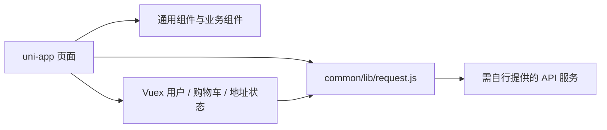

# 汉服电商移动端交互原型

面向汉服商品浏览与购物流程的 uni-app 前端项目，整理自服务外包创新创业竞赛的团队作品。仓库保留页面、组件、状态管理与接口封装，展示从分类搜索、商品详情到购物车和订单页面的交互组织方式。

**课程 / 竞赛团队项目；项目负责人 / 维护者：迟凡杰。** 当前公开的是移动端前端源码，不包含配套服务端、真实交易能力或已发布的应用。项目由团队协作完成，负责人信息不表示全部代码均为个人独立开发。

[页面目录](pages/) · [购物车状态](store/modules/cart.js) · [请求封装](common/lib/request.js) · [路由配置](pages.json) · [多端配置](manifest.json)

## 页面与交互

仓库包含 28 个 `.vue` / `.nvue` 页面文件和 48 个组件文件，组件数量包含已有的第三方 UI 组件，并不等同于原创组件数。

| 交互区域 | 源码入口 |
| --- | --- |
| 浏览与搜索 | `pages/index/`、`class/`、`search/`、`search-list/` |
| 商品详情与评价 | `pages/detail/`、`detail-comment/` |
| 购物车 | `pages/cart/`、`store/modules/cart.js`：选择/全选、合计、删除和角标 |
| 订单流程 | `pages/order-confirm/`、`order/`、`order-detail/`、`pay-methods/` |
| 优惠、物流与售后 | `pages/coupon/`、`logistics-detail/`、`after-sale/`、`order-refund/` |
| 用户与地址 | `pages/login/`、`my/`、`user-userinfo/`、`user-path-list/`、`user-path-edit/` |

这些页面构成了较完整的前端流程范围；其中接口返回、订单状态和支付结果依赖未包含在本仓库中的后端，不能将页面存在视作交易闭环已经验证。

## 技术结构

Vue 2 + uni-app + Vuex，使用 uni-ui 及自定义页面组件。首页保留 `.nvue` 实现和条件编译分支，针对 App、小程序、H5 处理部分导航与滚动差异。



```text
pages/              页面与交互逻辑
components/         通用组件、商品组件及保留的 uni-ui 组件
store/modules/      用户、购物车、地址状态
common/lib/         请求、辅助函数等
static/             当前保留的小型图片、图标与字体
main.js、App.vue     Vue / uni-app 入口
pages.json          页面路由与导航配置
manifest.json       多端构建、应用标识与 H5 代理配置
```

## 本地打开与配置

这是 HBuilderX 工程，根目录没有 `package.json` 或 npm 启动脚本。请通过 **HBuilderX → 文件 → 导入 → 从本地目录导入** 打开仓库，选择项目后通过“运行”菜单选择浏览器、模拟器或自己的测试设备。具体平台还需要相应 SDK / 开发者工具。

公开整理未运行 HBuilderX、构建安装包或完成端到端验证；旧版 Vue 2 / nvue 工程在不同 HBuilderX 版本上的兼容性需要实际检查。

| 配置位置 | 说明 |
| --- | --- |
| `common/lib/request.js` | 非 H5 的 `baseUrl` 默认指向本机演示 API；改为自己控制的后端。真机中的 `127.0.0.1` 指设备自身，需要使用可达的开发机地址。 |
| `manifest.json → h5.devServer.proxy` | H5 的 `/api` 请求通过开发代理转发；当前目标为本机 8080 端口。 |
| `manifest.json` 中各平台 `appid` | 旧应用标识已清空；需要编译到对应平台时填写自己的开发配置。 |

默认 H5 代理会移除 `/api` 前缀，与非 H5 的本机根地址对应；例如两端的商品请求最终都应到达自己服务的同一路径。修改地址时应同步检查代理的 `pathRewrite`。仓库没有附带 mock API、数据库、服务端或可用测试账号，运行前端不会自动生成商品和订单数据。请勿将服务端密钥放进前端配置。

## 当前版本的边界

- 没有真实支付、物流、优惠券服务或可用 App 安装包；支付页面代码只是对接入口。
- 部分课程示例文案和组件仍保留原状；部分被归档流程排除的图片、视频和大媒体可能导致资源缺失。
- 部分页面仍引用远程示例图片，打开页面可能产生外部资源请求；它们不代表本项目自有的服务或素材。
- 仓库暂无经过核验的运行截图和构建结果；项目定位是可阅读的交互原型源码。

## 团队贡献与第三方来源

这是团队课程 / 竞赛成果，后续个人贡献说明应依据实际分工和提交记录整理。保留 `components/uni-ui/`、uParse 等第三方代码中的原有注释和版权声明，不将其数量作为个人原创工作量。

仓库目前没有统一的项目 LICENSE。框架、组件、字体与图片继续受各自来源的许可约束，公开代码不等于对所有第三方素材授予再分发权；复用时应保留对应署名并确认授权范围。
